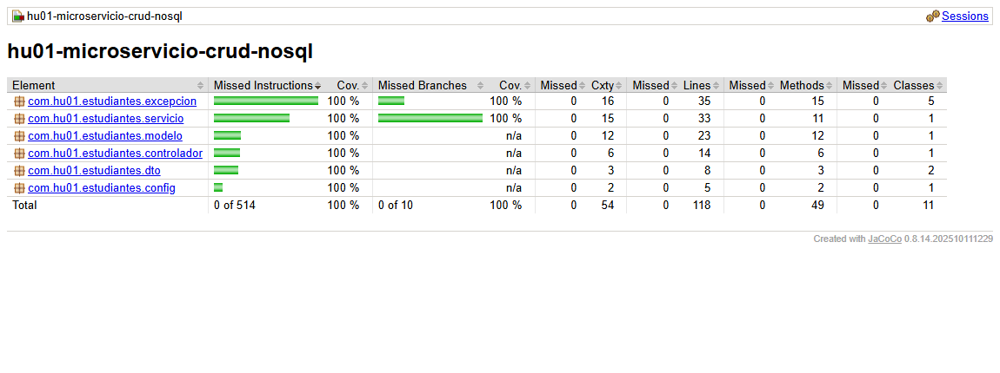
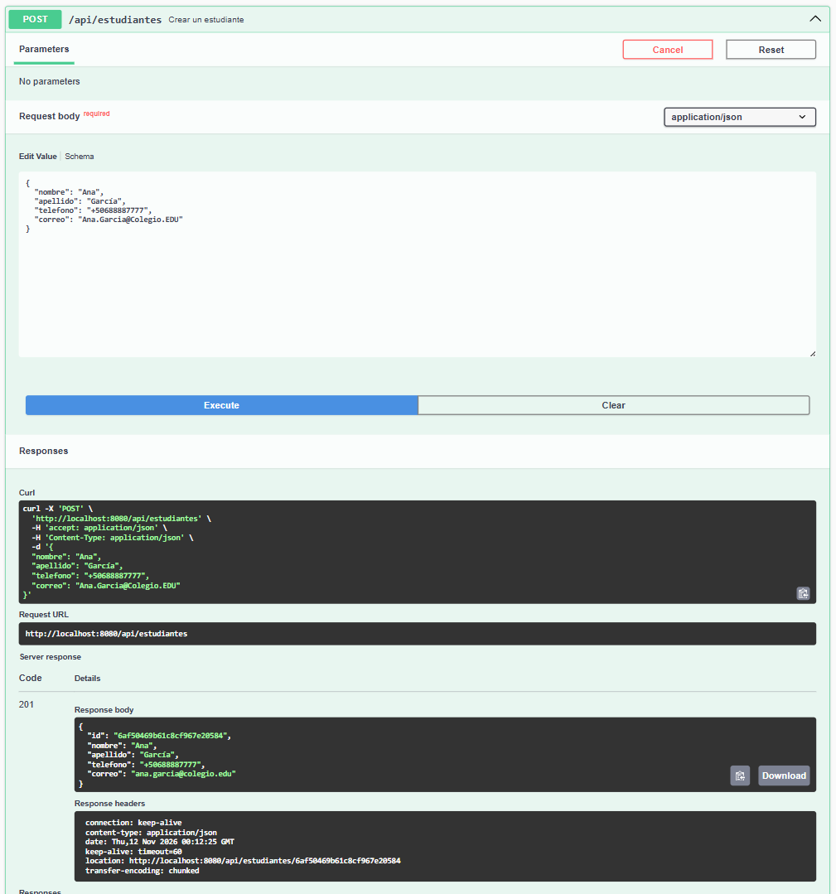
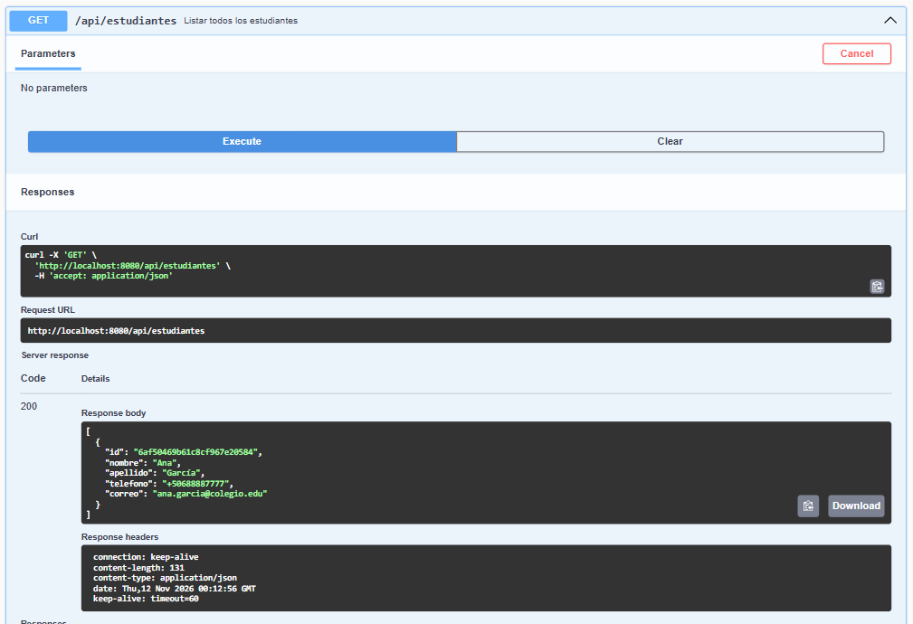
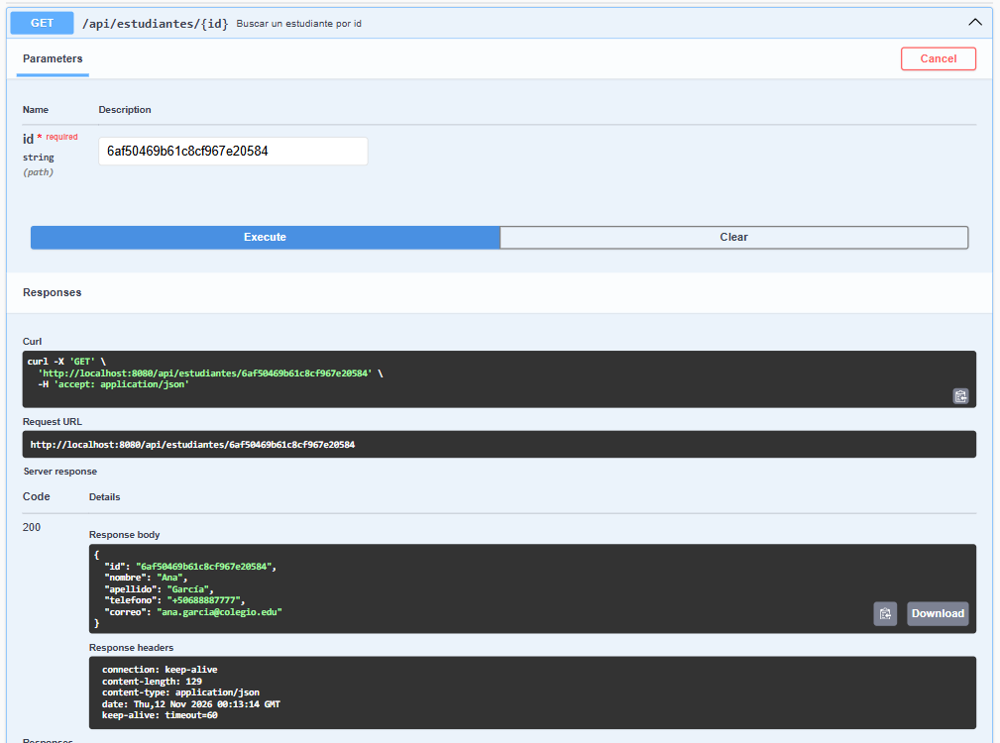
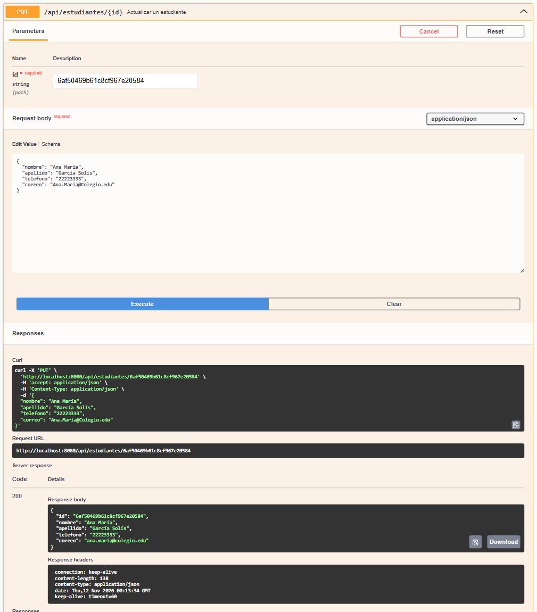
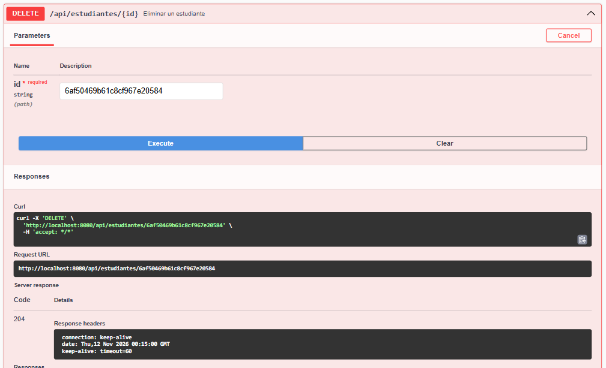
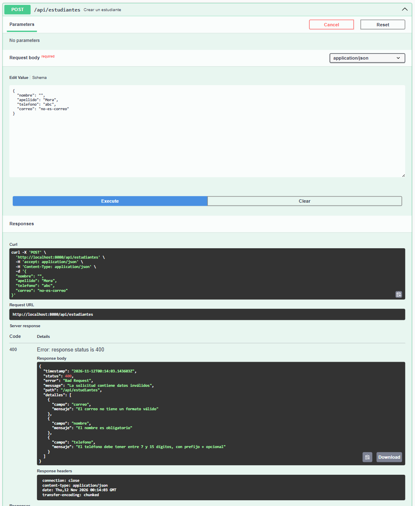
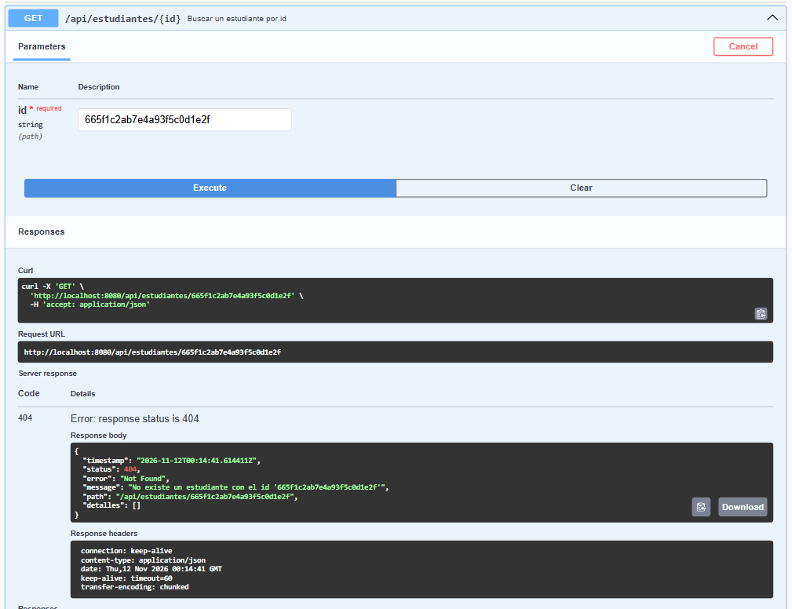
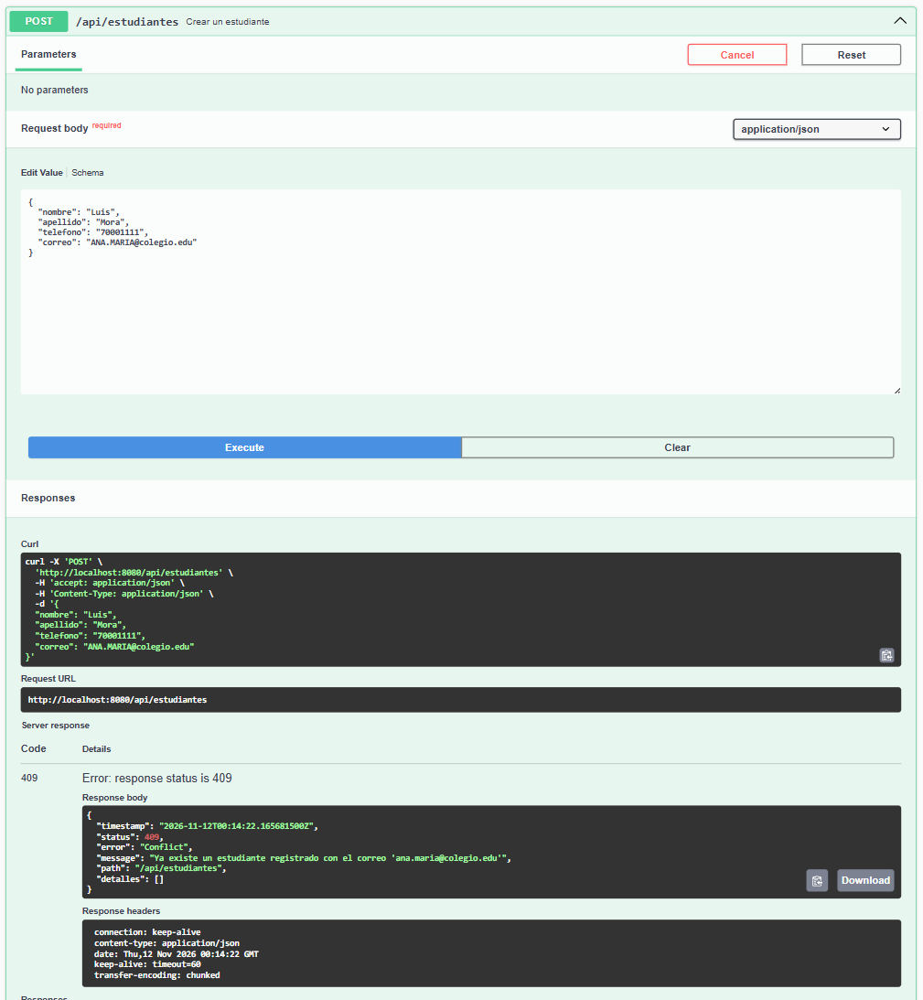

# Reporte técnico

## Microservicio RESTful CRUD de estudiantes con MongoDB

**Historia de usuario:** HU-01 — Microservicio CRUD con NoSQL, excepciones de dominio, manejador global, pruebas, cobertura y análisis de calidad

**Fecha:** 11 de noviembre de 2026

**Repositorio:** <https://github.com/OjedaSupreme/hu01-microservicio-crud-nosql> (rama `main`)

**Commit analizado:** `56857e4` (el código no cambia después; los commits posteriores solo agregan este reporte y sus evidencias)

---

## 1. Resumen

Se construyó, en un repositorio nuevo, un microservicio que administra los estudiantes de un colegio mediante una
API REST sobre MongoDB. Todos los criterios de la HU-01 quedaron cumplidos y verificados con ejecuciones reales:

| Verificación | Resultado |
|---|---|
| `mvnw.cmd clean verify` | Código de salida `0`, `BUILD SUCCESS` |
| Pruebas | 38 ejecutadas, 0 fallos, 0 errores, 0 omitidas |
| Cobertura de líneas (JaCoCo) | 100 % (118 de 118) — mínimo exigido: 80 % |
| Cobertura de ramas (JaCoCo) | 100 % (10 de 10) — mínimo exigido: 80 % |
| Quality Gate de SonarQube | `PASSED` (Sonar way): 0 bugs, 0 vulnerabilidades, 0 code smells |

## 2. Entorno de ejecución

| Componente | Versión usada |
|---|---|
| Sistema operativo | Windows (PowerShell) |
| JDK | OpenJDK Temurin 21.0.12 |
| Maven | 3.9.16 (wrapper `mvnw.cmd`) |
| Spring Boot | 4.1.1 |
| springdoc-openapi | 3.0.0 |
| MongoDB embebido (pruebas) | 7.0.28, vía `de.flapdoodle.embed.mongo.spring4x` 4.24.0 |
| MongoDB (ejecución real) | imagen `mongo:7` con Docker Compose |
| JaCoCo | 0.8.14 |
| SonarQube | Community Build 26.11.0.134175 (contenedor local) |
| sonar-maven-plugin | 5.5.0.6356 |
| Docker Engine | 29.9.2 |

## 3. Criterios de aceptación y cómo se cumplen

| # | Criterio | Cómo se cumple | Evidencia |
|---|---|---|---|
| 1 | Microservicio RESTful CRUD | `EstudianteControlador` expone `/api/estudiantes`: `POST` (201), `GET` (200), `GET /{id}` (200/404), `PUT /{id}` (200/404/409), `DELETE /{id}` (204/404) | Pruebas de integración y prueba manual (sección 7) |
| 2 | Persistencia NoSQL | Documento `Estudiante` (`id`, `nombre`, `apellido`, `telefono`, `correo`) en MongoDB con Spring Data (`EstudianteRepositorio`) | Las pruebas de integración leen los documentos persistidos |
| 3 | Correo único y normalizado | Índice único `@Indexed(unique = true)` más comprobación previa en `EstudianteServicio`; el correo se guarda sin espacios y en minúsculas | `mongoTieneIndiceUnicoEnCorreo`, `crear_conCorreoDuplicado_responde409`; índice visto en MongoDB real (sección 7) |
| 4 | Validaciones Jakarta con `@Valid` | `EstudianteRequest`: `@NotBlank`, `@Size`, `@Pattern` (teléfono) y `@Email`, con mensajes en español | `crear_conCamposInvalidos_responde400ConDetallePorCampo` |
| 5 | Excepciones de dominio | `RecursoNoEncontradoException` → 404 y `DatoDuplicadoException` → 409 (al crear y al cambiar el correo en una actualización) | Pruebas unitarias e integración de 404 y 409 |
| 6 | Manejador global | `ManejadorGlobalExcepciones` (`@RestControllerAdvice`) trata las dos excepciones de dominio, `MethodArgumentNotValidException`, `HttpMessageNotReadableException`, `DuplicateKeyException` (409) y un respaldo 500 | Pruebas de integración y `ManejadorGlobalExcepcionesTest` |
| 7 | Cuerpo de error uniforme | Record `ErrorRespuesta`: `timestamp`, `status`, `error`, `message`, `path`, `detalles` (lista de `campo` y `mensaje`) | Todas las pruebas de error verifican estos campos |
| 8 | El 500 no filtra trazas | El detalle va al log del servidor; el cliente recibe un mensaje genérico | `errorInesperado_responde500SinFiltrarDetalles` |
| 9 | Pruebas unitarias con Mockito | `EstudianteServicioTest`: `@ExtendWith(MockitoExtension.class)`, `@Mock`, `@InjectMocks`, sin contexto de Spring | 12 pruebas en verde |
| 10 | Pruebas de integración | `EstudianteApiIntegrationTest`: `@SpringBootTest` + `@AutoConfigureMockMvc` contra MongoDB embebido; la colección se limpia antes de cada prueba | 24 pruebas en verde |
| 11 | JaCoCo ≥ 80 % | Regla `check` en la fase `verify` con mínimo 0.80 de líneas y de ramas; solo se excluye `EstudiantesApplication` | 100 % de líneas y de ramas (sección 5) |
| 12 | Análisis SonarQube | `sonar-maven-plugin`, `sonar-project.properties` y `compose.yaml` con SonarQube Community | Quality Gate `PASSED` (sección 6) |
| 13 | Swagger UI operativo | springdoc-openapi en `/swagger-ui/index.html` | `swaggerUi_estaDisponible`, `openApi_describeLosEndpoints` y capturas de solicitudes reales (sección 8) |
| 14 | Calidad de código | Inyección por constructor, sin Lombok, sin `System.out`, consultas derivadas de Spring Data (sin concatenación), sin secretos en el repositorio | 0 incidencias en SonarQube |

## 4. Diseño

### 4.1 Capas

| Paquete | Responsabilidad |
|---|---|
| `controlador` | Endpoints REST, códigos HTTP y documentación OpenAPI |
| `servicio` | Reglas de negocio: normalización del correo, unicidad y existencia |
| `repositorio` | Acceso a MongoDB con Spring Data |
| `modelo` | Documento `Estudiante` |
| `dto` | `EstudianteRequest` (entrada validada) y `EstudianteResponse` (salida) |
| `excepcion` | Excepciones de dominio, manejador global y cuerpo de error |
| `config` | Metadatos de OpenAPI |

### 4.2 Tratamiento de errores

| Situación | Excepción | HTTP |
|---|---|---|
| El id no existe | `RecursoNoEncontradoException` | 404 |
| Correo ya registrado (crear o actualizar) | `DatoDuplicadoException` | 409 |
| MongoDB rechaza el índice único | `DuplicateKeyException` | 409 |
| Campos inválidos | `MethodArgumentNotValidException` | 400, con detalle por campo |
| JSON ilegible | `HttpMessageNotReadableException` | 400 |
| Método, tipo de contenido o ruta no admitidos | Errores estándar de Spring MVC | 405, 415, 404 |
| Cualquier otro fallo | `Exception` | 500 genérico, sin traza |

### 4.3 Decisiones relevantes

- **Unicidad en dos niveles.** El servicio comprueba el correo para dar un mensaje claro; el índice único de MongoDB
  cubre la carrera entre dos peticiones simultáneas. Ambos caminos responden 409.
- **Actualización.** La unicidad solo se valida cuando el correo cambia: conservar el correo propio no es un duplicado.
- **Spring Boot 4.** La propiedad de conexión es `spring.mongodb.uri` (antes `spring.data.mongodb.uri`). Se define como
  `${MONGODB_URI:mongodb://localhost:27017/estudiantes}`, de modo que las credenciales, si existen, llegan por
  variable de entorno.
- **MongoDB embebido en lugar de Testcontainers.** Las pruebas no dependen de que Docker esté en ejecución. La
  propiedad `de.flapdoodle.mongodb.embedded.version=7.0.28` (perfil `test`) fija la versión. Flapdoodle arranca
  `mongod` en un puerto libre y redirige el cliente hacia él; la prueba `elClienteUsaElMongoEmbebido` comprueba que
  la aplicación no se conecta a ningún MongoDB externo.

## 5. Pruebas y cobertura

### 5.1 Resultado de `mvnw.cmd clean verify`

Salida real (resumida) de la ejecución final, guardada en `docs/evidencias/mvnw-clean-verify.txt`:

```text
> mvnw.cmd -B clean verify   (codigo de salida: 0)

[INFO] Running com.hu01.estudiantes.EstudianteApiIntegrationTest
[INFO] Tests run: 24, Failures: 0, Errors: 0, Skipped: 0, Time elapsed: 8.177 s -- in com.hu01.estudiantes.EstudianteApiIntegrationTest
[INFO] Running com.hu01.estudiantes.excepcion.ManejadorGlobalExcepcionesTest
[INFO] Tests run: 2, Failures: 0, Errors: 0, Skipped: 0, Time elapsed: 0.903 s -- in com.hu01.estudiantes.excepcion.ManejadorGlobalExcepcionesTest
[INFO] Running com.hu01.estudiantes.servicio.EstudianteServicioTest
[INFO] Tests run: 12, Failures: 0, Errors: 0, Skipped: 0, Time elapsed: 0.572 s -- in com.hu01.estudiantes.servicio.EstudianteServicioTest
[INFO] Results:
[INFO] Tests run: 38, Failures: 0, Errors: 0, Skipped: 0
[INFO] --- jacoco:0.8.14:report (jacoco-report) @ estudiantes ---
[INFO] --- jacoco:0.8.14:check (jacoco-check) @ estudiantes ---
[INFO] All coverage checks have been met.
[INFO] BUILD SUCCESS
[INFO] Total time:  16.424 s
[INFO] Finished at: 2026-11-11T17:55:03-06:00
```

### 5.2 Escenarios cubiertos

**Unitarias del servicio — `EstudianteServicioTest` (12, Mockito, sin Spring)**

| Operación | Éxito | Error |
|---|---|---|
| Crear | Guarda con el correo normalizado | Correo duplicado → `DatoDuplicadoException` |
| Listar | Devuelve todos; lista vacía | — |
| Buscar | Devuelve el estudiante | Inexistente → `RecursoNoEncontradoException` |
| Actualizar | Con correo nuevo libre; conservando el correo propio | Correo de otro estudiante → `DatoDuplicadoException`; inexistente → `RecursoNoEncontradoException` |
| Eliminar | Borra el estudiante | Inexistente → `RecursoNoEncontradoException` |

**Integración HTTP — `EstudianteApiIntegrationTest` (24, MongoDB embebido)**

| Área | Casos |
|---|---|
| Crear | 201 con `Location` y documento persistido; 400 con varios campos inválidos; 400 sin campos obligatorios; 400 por JSON mal formado; 409 por correo duplicado |
| Listar y buscar | 200 con lista vacía; 200 con todos; 200 por id; 404 por id inexistente; 404 por id sin formato de ObjectId |
| Actualizar | 200 con cambios persistidos; 200 conservando el correo; 404; 409 por correo de otro estudiante; 400 por datos inválidos |
| Eliminar | 204 y el documento desaparece; 404 |
| Infraestructura | El cliente apunta al MongoDB embebido; índice único en `correo` |
| Errores del framework | 405, 415 y 404 de ruta inexistente con el cuerpo uniforme |
| Documentación | `/v3/api-docs` describe los cinco endpoints; `/swagger-ui/index.html` responde 200 |

**Capa web — `ManejadorGlobalExcepcionesTest` (2, `@WebMvcTest`)**

- 500 genérico sin traza ni mensaje interno ante un fallo inesperado.
- 409 cuando MongoDB lanza `DuplicateKeyException`, sin exponer el mensaje del driver.

### 5.3 Cobertura JaCoCo

- Reporte HTML: `target/site/jacoco/index.html` (se genera con `mvnw.cmd clean verify` o `mvnw.cmd test`).
- XML para SonarQube: `target/site/jacoco/jacoco.xml`.
- Copia del CSV de esta ejecución: `docs/evidencias/jacoco.csv`.

Totales leídos de `target/site/jacoco/jacoco.xml`:

| Contador | Cubierto | Sin cubrir | Cobertura |
|---|---|---|---|
| Líneas | 118 | 0 | **100 %** |
| Ramas | 10 | 0 | **100 %** |
| Instrucciones | 514 | 0 | 100 % |
| Métodos | 49 | 0 | 100 % |
| Clases | 11 | 0 | 100 % |

Detalle por clase (de `jacoco.csv`):

| Clase | Líneas cubiertas | Líneas sin cubrir | Ramas cubiertas | Ramas sin cubrir |
|---|---|---|---|---|
| `servicio.EstudianteServicio` | 33 | 0 | 8 | 0 |
| `excepcion.ManejadorGlobalExcepciones` | 29 | 0 | 2 | 0 |
| `modelo.Estudiante` | 23 | 0 | 0 | 0 |
| `controlador.EstudianteControlador` | 14 | 0 | 0 | 0 |
| `dto.EstudianteResponse` | 7 | 0 | 0 | 0 |
| `config.OpenApiConfig` | 5 | 0 | 0 | 0 |
| `excepcion.RecursoNoEncontradoException` | 2 | 0 | 0 | 0 |
| `excepcion.DatoDuplicadoException` | 2 | 0 | 0 | 0 |
| `dto.EstudianteRequest` | 1 | 0 | 0 | 0 |
| `excepcion.ErrorRespuesta` | 1 | 0 | 0 | 0 |
| `excepcion.DetalleError` | 1 | 0 | 0 | 0 |

La única clase excluida del cálculo es `EstudiantesApplication` (clase de arranque).

Captura del reporte HTML generado en esta ejecución (`docs/evidencias/jacoco-index.png`):



## 6. Análisis con SonarQube

El análisis **sí se ejecutó** contra un servidor real. Docker Desktop estaba detenido al comenzar; se inició, el
daemon respondió y se levantó SonarQube Community con `docker compose up -d sonarqube`.

Comando:

```powershell
$env:SONAR_TOKEN = "<token>"
.\mvnw.cmd clean verify
.\mvnw.cmd sonar:sonar "-Dsonar.qualitygate.wait=true"
```

Salida real del escáner:

```text
[INFO] Communicating with SonarQube Community Build 26.11.0.134175
[INFO] 17 files indexed (done) | time=12ms
[INFO] Sensor JaCoCo XML Report Importer [jacoco]
[INFO] Importing 1 report(s). Turn your logs in debug mode in order to see the exhaustive list.
[INFO] ------------- Check Quality Gate status
[INFO] QUALITY GATE STATUS: PASSED - View details on http://localhost:9000/dashboard?id=hu01-microservicio-crud-nosql
[INFO] BUILD SUCCESS
[INFO] Finished at: 2026-11-11T17:55:35-06:00
```

**Quality Gate: `PASSED`** (se aplicó «Sonar way», el Quality Gate predeterminado). Condiciones devueltas por
`api/qualitygates/project_status` (respuesta completa en `docs/evidencias/sonarqube-quality-gate.json`):

| Condición | Umbral | Valor obtenido | Estado |
|---|---|---|---|
| Cobertura en código nuevo | ≥ 80 % | 100.0 % | OK |
| Líneas duplicadas en código nuevo | ≤ 3 % | 0.0 % | OK |
| Incidencias nuevas | 0 | 0 | OK |

Medidas del proyecto devueltas por `api/measures/component` (`docs/evidencias/sonarqube-medidas.json`):

| Métrica | Valor |
|---|---|
| Bugs | 0 |
| Vulnerabilidades | 0 |
| Code smells | 0 |
| Security hotspots | 0 |
| Cobertura | 100.0 % (118 líneas y 10 condiciones por cubrir, 0 sin cubrir) |
| Líneas duplicadas | 0.0 % |
| Pruebas | 38 (0 fallos, 0 errores) |
| Fiabilidad / Seguridad / Mantenibilidad | A / A / A |

Análisis registrado por el servidor: `2026-11-11T23:55:23+0000`, revisión
`56857e47a6797bb868006d5f1cb42848a6889401`.

> **Evidencia pendiente del usuario: captura del panel web de SonarQube.** El panel exige iniciar sesión de forma
> interactiva y, en el primer ingreso, elegir una contraseña nueva para `admin`. Esa decisión corresponde al dueño
> de la instancia, por lo que no se cambió la contraseña, no se crearon usuarios y no se tomó la captura. Para
> completarla: iniciar sesión en <http://localhost:9000/dashboard?id=hu01-microservicio-crud-nosql> (con el
> contenedor en ejecución), capturar el panel y agregar la imagen a `docs/evidencias/`. Mientras tanto, la
> evidencia del análisis son las respuestas reales de la API de SonarQube citadas arriba.

## 7. Verificación manual contra MongoDB real

Además de las pruebas automáticas, el JAR generado se ejecutó contra un contenedor `mongo:7` y se recorrieron los
endpoints con `curl`. Respuestas reales (11 de noviembre de 2026):

| Solicitud | HTTP | Respuesta |
|---|---|---|
| `POST /api/estudiantes` (correo `Ana.Garcia@Colegio.EDU`) | 201 | `{"id":"6af4feefe425ed1c9108495c","nombre":"Ana","apellido":"García","telefono":"+50688887777","correo":"ana.garcia@colegio.edu"}` |
| `POST` con el mismo correo | 409 | `"message":"Ya existe un estudiante registrado con el correo 'ana.garcia@colegio.edu'"` |
| `POST` con nombre vacío, teléfono `abc` y correo inválido | 400 | `"message":"La solicitud contiene datos inválidos"` y tres entradas en `detalles` (`correo`, `nombre`, `telefono`) |
| `POST` con JSON truncado | 400 | `"message":"El cuerpo de la solicitud no es un JSON válido o no se puede leer"` |
| `GET /api/estudiantes` | 200 | Lista con el estudiante creado |
| `GET /api/estudiantes/{id}` | 200 | El estudiante creado |
| `GET /api/estudiantes/665f1c2ab7e4a93f5c0d1e2f` | 404 | `"message":"No existe un estudiante con el id '665f1c2ab7e4a93f5c0d1e2f'"` |
| `PUT /api/estudiantes/{id}` | 200 | `{"id":"6af4feefe425ed1c9108495c","nombre":"Luis","apellido":"Mora","telefono":"22223333","correo":"luis.mora@colegio.edu"}` |
| `PUT /api/estudiantes/665f1c2ab7e4a93f5c0d1e2f` | 404 | Cuerpo de error uniforme |
| `DELETE /api/estudiantes/{id}` | 204 | Sin cuerpo |
| `DELETE /api/estudiantes/{id}` (repetido) | 404 | Cuerpo de error uniforme |
| `GET /swagger-ui/index.html` | 200 | Swagger UI |
| `GET /swagger-ui.html` | 302 | Redirige a `/swagger-ui/index.html` |
| `GET /v3/api-docs` | 200 | Especificación OpenAPI |

Índices creados por la aplicación en ese MongoDB (`db.estudiantes.getIndexes()`, salida compactada a una línea
por índice):

```text
[
  { v: 2, key: { _id: 1 }, name: '_id_' },
  { v: 2, key: { correo: 1 }, name: 'correo', unique: true }
]
```

## 8. Evidencias de los endpoints en Swagger UI

Capturas de pantalla de Swagger UI (`http://localhost:8080/swagger-ui/index.html`) tomadas mientras el JAR del
proyecto corría contra un contenedor `mongo:7` (puerto 27018). Cada solicitud se envió desde el navegador con
**Try it out → Execute**; las imágenes muestran la solicitud enviada, el código HTTP y el cuerpo que respondió el
servidor.

- **Cómo se tomaron:** con el navegador integrado de Cursor, controlado por el protocolo de DevTools. La imagen
  es la que entrega el propio navegador (`Page.captureScreenshot`), recortada al bloque de la operación. No se
  editó ni retocó ninguna.
- **Fecha y hora:** el encabezado `date` de las respuestas está en GMT (12 de noviembre de 2026, 00:12 a 00:15),
  que corresponde al 11 de noviembre de 2026 entre las 18:12 y las 18:15, hora local (UTC−6).
- **Datos:** las ocho capturas pertenecen a una misma sesión, en este orden: crear, listar, buscar, actualizar,
  crear inválido, crear duplicado, buscar inexistente y eliminar. El estudiante creado tiene el id
  `6af50469b61c8cf967e20584`. Al terminar, la colección quedó vacía.

### 8.1 Crear un estudiante — `POST /api/estudiantes` → 201

Crea el estudiante y responde `201 Created` con el recurso y el encabezado `Location`; el correo enviado como
`Ana.Garcia@Colegio.EDU` se devuelve normalizado en minúsculas.



### 8.2 Listar estudiantes — `GET /api/estudiantes` → 200

Responde `200 OK` con una lista que contiene el estudiante recién creado.



### 8.3 Buscar por id — `GET /api/estudiantes/{id}` → 200

Responde `200 OK` con el estudiante cuyo id se envió en la ruta.



### 8.4 Actualizar — `PUT /api/estudiantes/{id}` → 200

Reemplaza los datos del estudiante y responde `200 OK` con los valores nuevos, conservando el mismo id.



### 8.5 Eliminar — `DELETE /api/estudiantes/{id}` → 204

Elimina el estudiante y responde `204 No Content`, sin cuerpo.



### 8.6 Datos inválidos — `POST /api/estudiantes` → 400

Con nombre vacío, teléfono `abc` y correo sin formato, el manejador global responde `400 Bad Request` con el
detalle por campo (`correo`, `nombre`, `telefono`).



### 8.7 Id inexistente — `GET /api/estudiantes/{id}` → 404

Con un id que no existe, `RecursoNoEncontradoException` se traduce en `404 Not Found` con el cuerpo de error
uniforme.



### 8.8 Correo duplicado — `POST /api/estudiantes` → 409

Al crear otro estudiante con un correo ya registrado (enviado en mayúsculas, `ANA.MARIA@colegio.edu`),
`DatoDuplicadoException` se traduce en `409 Conflict`.



## 9. Cómo reproducir

```powershell
git clone https://github.com/OjedaSupreme/hu01-microservicio-crud-nosql.git
cd hu01-microservicio-crud-nosql

# Pruebas, cobertura y regla del 80 %
.\mvnw.cmd clean verify
start target\site\jacoco\index.html

# Ejecución
docker compose up -d mongo
.\mvnw.cmd spring-boot:run        # http://localhost:8080/swagger-ui/index.html

# SonarQube
docker compose up -d sonarqube
$env:SONAR_TOKEN = "<token generado en SonarQube>"
.\mvnw.cmd clean verify sonar:sonar "-Dsonar.qualitygate.wait=true"
```

## 10. Observaciones

- **Criterios pendientes:** ninguno en el código. Queda una evidencia pendiente del usuario, descrita más abajo.
- **Evidencias de los endpoints:** las capturas del cliente HTTP están en la sección 8 y se tomaron en Swagger UI
  con solicitudes reales. No se usó Postman.
- **Evidencia pendiente del usuario:** la captura del panel web de SonarQube. Requiere que el usuario inicie sesión
  y elija su contraseña (ver la nota de la sección 6). El resultado del análisis sí está respaldado por las
  respuestas reales de la API de SonarQube.
- **Imágenes:** ninguna fue fabricada ni editada.
- **Primera ejecución de las pruebas:** descarga el binario de MongoDB 7.0.28 y tarda unos minutos; las siguientes
  usan la caché de `~/.embedmongo` (la ejecución final tardó 16 s).
- **Puerto 27017 ocupado:** si la máquina ya tiene un MongoDB local en ese puerto, el contenedor puede publicarse en
  otro con la variable `MONGO_PORT` y la aplicación apuntarse a él con `MONGODB_URI` (así se hizo en la verificación
  manual, con el puerto 27018).
- **Credenciales:** el repositorio no contiene contraseñas reales. `sonar` / `sonar` en `compose.yaml` es el valor
  por defecto de la base de datos local de SonarQube y puede cambiarse por variables de entorno.
